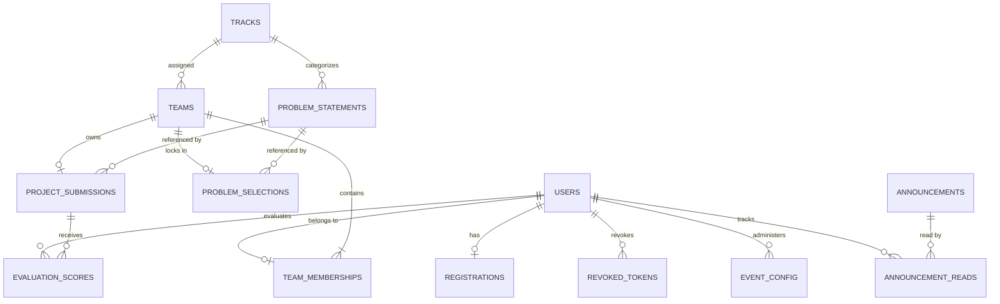
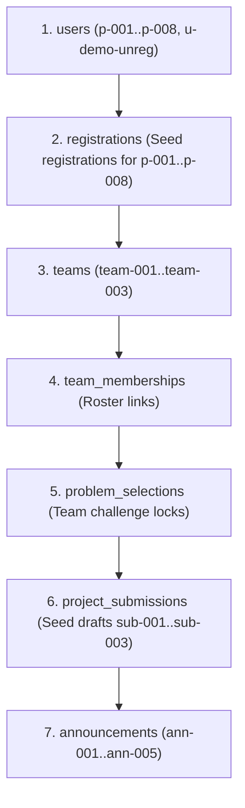

# CAMPUSCRAFTERS HACKATHON PLATFORM — DATABASE INTEGRATION SPECIFICATION
## Technical Handover & Repository Contract for Database Engineering

**Document Version:** 1.2.0 (Phase 1.5 Contract Revision)  
**Target Assignee:** Atharva Kharat (Database Engineer)  
**Authors:** Mangesh Mahajan & Vaibhav Patil Dhumal (Backend & API Engineering)  
**Date:** November 4, 2026  
**Target Repository:** `CampusCrafters_DiwaliHackthon_Platform`  
**Target Database Engine:** PostgreSQL (Supabase)  

---

## 1. Executive Summary & Division of Responsibilities

This specification establishes the official technical contract between the **Backend Engineering Team** (Mangesh Mahajan & Vaibhav Patil Dhumal) and the **Database Engineering Team** (Atharva Kharat).

### Explicit Boundaries
- **Backend Developer Ownership:** Exposes abstract Python repository interfaces (`abc.ABC`) in `src/interfaces/`, enforces domain business rules, handles request validation, and maintains thread-safe in-memory mock adapters **strictly for local development and standalone pytest execution**.
- **Database Developer Ownership:** Retains sole ownership of the production database layer: PostgreSQL / Supabase configuration, relational table schemas (DDL), primary and foreign keys, composite indexes, uniqueness constraints, transaction isolation, Alembic migrations, and concrete SQL repository adapters implementing our Python interfaces.
- **Production Persistence Requirement:** In-memory repositories are strictly forbidden in production (`FLASK_ENV=production`). The backend application factory will fail fast at startup if `DATABASE_URL` is missing or if memory persistence is configured.

---

## 2. Entity Relational Models & Schema Requirements



### Table 1: `users`
Represents user identities provisioned via Campus Crafter SSO (or development simulation).
> **Important:** In production, authentication is handled via SSO. Passwords are not stored in production.

| Column | Type | Constraints | Description |
| :--- | :--- | :--- | :--- |
| `id` | `VARCHAR(64)` | `PRIMARY KEY` | User ID (e.g., `p-001`, `u-xxxx`). |
| `email` | `VARCHAR(255)` | `NOT NULL, UNIQUE` | Unique student email. Indexed. |
| `display_name` | `VARCHAR(128)` | `NOT NULL` | Full name / Display name. |
| `college` | `VARCHAR(255)` | `NOT NULL` | Institution / College name. |
| `course` | `VARCHAR(128)` | `NULLABLE` | Degree / Academic program. |
| `year` | `VARCHAR(64)` | `NULLABLE` | Academic year (e.g. `3rd Year`). |
| `phone` | `VARCHAR(32)` | `NULLABLE, UNIQUE` | Unique phone contact. |
| `bio` | `TEXT` | `NULLABLE` | Participant biography / elevator pitch. |
| `skills` | `JSONB` / `TEXT[]` | `NOT NULL, DEFAULT '[]'` | Array of technical skills. |
| `roles` | `VARCHAR(32)[]`| `NOT NULL, DEFAULT '{"participant"}'` | Roles: `participant`, `judge`, `admin`. |
| `password_hash` | `VARCHAR(255)` | `NULLABLE` | **Development mock auth only**. Never used in production SSO. |
| `created_at` | `TIMESTAMPTZ` | `NOT NULL, DEFAULT NOW()` | UTC registration timestamp. |
| `updated_at` | `TIMESTAMPTZ` | `NOT NULL, DEFAULT NOW()` | UTC profile update timestamp. |

---

### Table 2: `registrations`
Stores official hackathon event registrations, ticket passes, and participant metadata.

| Column | Type | Constraints | Description |
| :--- | :--- | :--- | :--- |
| `id` | `VARCHAR(64)` | `PRIMARY KEY` | Registration ID (e.g. `REG-2026-XXXX`). |
| `user_id` | `VARCHAR(64)` | `NOT NULL, UNIQUE, FK -> users(id)` | 1-to-1 link to user identity. |
| `ticket_code` | `VARCHAR(32)` | `NOT NULL, UNIQUE` | Format `CS26-XXXX-XXXX`. Indexed. |
| `track_id` | `VARCHAR(64)` | `NOT NULL, FK -> tracks(id)` | Chosen hackathon track. |
| `experience` | `VARCHAR(32)` | `NOT NULL` | `beginner`, `intermediate`, `advanced`. |
| `interests` | `JSONB` / `TEXT[]` | `DEFAULT '[]'` | Sub-domains of interest. |
| `rules_accepted` | `BOOLEAN` | `NOT NULL, DEFAULT TRUE` | Agreement to hackathon rules. |
| `status` | `VARCHAR(32)` | `NOT NULL, DEFAULT 'confirmed'` | `confirmed`, `cancelled`. |
| `registered_at` | `TIMESTAMPTZ` | `NOT NULL, DEFAULT NOW()` | UTC timestamp. |

---

### Table 3: `waitlist`
Stores waitlisted participants when event state reaches `full`.

| Column | Type | Constraints | Description |
| :--- | :--- | :--- | :--- |
| `id` | `VARCHAR(64)` | `PRIMARY KEY` | Waitlist ID (e.g. `WL-XXXX`). |
| `full_name` | `VARCHAR(128)` | `NOT NULL` | Applicant name. |
| `email` | `VARCHAR(255)` | `NOT NULL, UNIQUE` | Unique contact email. |
| `college` | `VARCHAR(255)` | `NULLABLE` | Institution name. |
| `track_interest` | `VARCHAR(64)` | `NOT NULL, DEFAULT 'any'` | Track interest. |
| `submitted_at` | `TIMESTAMPTZ` | `NOT NULL, DEFAULT NOW()` | Submission timestamp. |

---

### Table 4: `tracks`
Hackathon competition tracks.

| Column | Type | Constraints | Description |
| :--- | :--- | :--- | :--- |
| `id` | `VARCHAR(64)` | `PRIMARY KEY` | `fintech`, `social-good`, `web3`, `beginner`. |
| `name` | `VARCHAR(128)` | `NOT NULL` | Track display name. |
| `short_description` | `TEXT` | `NOT NULL` | Track subtitle. |
| `detailed_description` | `TEXT` | `NOT NULL` | Detailed track overview. |
| `accent_color` | `VARCHAR(16)` | `NOT NULL` | Hex color code (e.g. `#2B50FF`). |
| `tags` | `JSONB` / `TEXT[]` | `NOT NULL, DEFAULT '[]'` | Search tags. |

---

### Table 5: `problem_statements`
Available hackathon challenge statements.

| Column | Type | Constraints | Description |
| :--- | :--- | :--- | :--- |
| `id` | `VARCHAR(64)` | `PRIMARY KEY` | `ps-ft-01`, `ps-sg-01`, etc. |
| `track_id` | `VARCHAR(64)` | `NOT NULL, FK -> tracks(id)` | Parent track. |
| `title` | `VARCHAR(255)` | `NOT NULL` | Problem title. |
| `description` | `TEXT` | `NOT NULL` | Problem prompt. |
| `difficulty` | `VARCHAR(32)` | `NOT NULL` | `Beginner`, `Intermediate`, `Advanced`. |
| `domain` | `VARCHAR(128)` | `NOT NULL` | Industry domain. |
| `tags` | `JSONB` / `TEXT[]` | `NOT NULL, DEFAULT '[]'` | Tags. |
| `evaluation_criteria` | `JSONB` / `TEXT[]`| `NOT NULL, DEFAULT '[]'` | Scoring rubrics. |
| `expected_deliverables` | `JSONB` / `TEXT[]`| `NOT NULL, DEFAULT '[]'` | Required output artifacts. |
| `is_active` | `BOOLEAN` | `NOT NULL, DEFAULT TRUE` | Active toggle. |

---

### Table 6: `teams`
Teams formed by participants.

| Column | Type | Constraints | Description |
| :--- | :--- | :--- | :--- |
| `id` | `VARCHAR(64)` | `PRIMARY KEY` | Unique Team ID (e.g. `team-001`). |
| `name` | `VARCHAR(128)` | `NOT NULL` | Team name (min 3 chars). |
| `join_code` | `VARCHAR(16)` | `NOT NULL, UNIQUE` | `CS-XXXX` or seed `CC-4F7K`. Uppercase indexed. |
| `track_id` | `VARCHAR(64)` | `NOT NULL, FK -> tracks(id)` | Registered track. |
| `leader_id` | `VARCHAR(64)` | `NOT NULL, FK -> users(id)` | Designated team leader. |
| `status` | `VARCHAR(32)` | `NOT NULL, DEFAULT 'active'` | `active`, `disbanded`. |
| `created_at` | `TIMESTAMPTZ` | `NOT NULL, DEFAULT NOW()` | Creation timestamp. |

---

### Table 7: `team_memberships`
Enforces team membership and the strict **1-team-per-user constraint**.

| Column | Type | Constraints | Description |
| :--- | :--- | :--- | :--- |
| `id` | `BIGSERIAL` | `PRIMARY KEY` | Membership record ID. |
| `team_id` | `VARCHAR(64)` | `NOT NULL, FK -> teams(id) ON DELETE CASCADE` | Team reference. |
| `user_id` | `VARCHAR(64)` | `NOT NULL, UNIQUE, FK -> users(id)` | **CRITICAL: UNIQUE constraint enforces 1-team-per-user.** |
| `joined_at` | `TIMESTAMPTZ` | `NOT NULL, DEFAULT NOW()` | Join timestamp. |

---

### Table 8: `problem_selections`
The **canonical authoritative single source of truth** for a team's chosen challenge.

| Column | Type | Constraints | Description |
| :--- | :--- | :--- | :--- |
| `id` | `BIGSERIAL` | `PRIMARY KEY` | Selection record ID. |
| `team_id` | `VARCHAR(64)` | `NOT NULL, UNIQUE, FK -> teams(id) ON DELETE CASCADE` | **1 selection per team.** |
| `problem_statement_id` | `VARCHAR(64)` | `NOT NULL, FK -> problem_statements(id)` | Selected problem. |
| `selected_by` | `VARCHAR(64)` | `NOT NULL, FK -> users(id)` | User ID of leader who selected. |
| `selected_at` | `TIMESTAMPTZ` | `NOT NULL, DEFAULT NOW()` | Selection timestamp. |

---

### Table 9: `project_submissions`
Project submission drafts and final locking records.

| Column | Type | Constraints | Description |
| :--- | :--- | :--- | :--- |
| `id` | `VARCHAR(64)` | `PRIMARY KEY` | Submission ID (e.g. `sub-001`). |
| `team_id` | `VARCHAR(64)` | `NOT NULL, UNIQUE, FK -> teams(id) ON DELETE CASCADE` | **1 submission per team.** |
| `problem_statement_id` | `VARCHAR(64)` | `NULLABLE, FK -> problem_statements(id)` | **Nullable during draft saving; required at final submission.** |
| `project_title` | `VARCHAR(128)` | `NOT NULL, DEFAULT ''` | Project title (3–100 chars). |
| `short_description` | `VARCHAR(255)` | `NOT NULL, DEFAULT ''` | Short tagline (10–250 chars). |
| `detailed_description` | `TEXT` | `NOT NULL, DEFAULT ''` | Full overview (>=30 chars). |
| `repository_url` | `VARCHAR(512)` | `NOT NULL, DEFAULT ''` | Valid HTTPS URL. |
| `demo_url` | `VARCHAR(512)` | `NULLABLE, DEFAULT ''` | Live demo URL. |
| `presentation_url` | `VARCHAR(512)` | `NULLABLE, DEFAULT ''` | Walkthrough video / deck URL. |
| `tech_stack` | `JSONB` / `TEXT[]` | `NOT NULL, DEFAULT '[]'` | Array of technology tags. |
| `status` | `VARCHAR(32)` | `NOT NULL, DEFAULT 'DRAFT'` | `DRAFT`, `SUBMITTED`. |
| `created_at` | `TIMESTAMPTZ` | `NOT NULL, DEFAULT NOW()` | Draft initialization timestamp. |
| `updated_at` | `TIMESTAMPTZ` | `NOT NULL, DEFAULT NOW()` | Last auto-save timestamp. |
| `submitted_at` | `TIMESTAMPTZ` | `NULLABLE` | Final immutable submission timestamp. |

#### Architectural Relationship: `problem_selections` vs `project_submissions.problem_statement_id`
1. **Draft Stage (No Problem Selected):** A draft can be saved before a problem statement is locked in `problem_selections`. In that state, `project_submissions.problem_statement_id` is `NULL`. Auto-saving succeeds (HTTP 200).
2. **Draft Stage (Problem Selected):** When a problem statement is selected via `PUT /api/v1/teams/{id}/problem-statement`, any existing draft record for that team is automatically updated with the matching `problem_statement_id`.
3. **Problem Selection Cleared:** If `DELETE /api/v1/teams/{id}/problem-statement` is executed, the draft's `problem_statement_id` is set to `NULL`.
4. **Final Submission Execution:** `POST /api/v1/teams/{id}/submission/submit` strictly validates that an active selection exists in `problem_selections`. If missing or `NULL`, the submission is rejected with HTTP 400 `PROBLEM_STATEMENT_REQUIRED`.
5. **Post-Submission Freeze:** Once `status === 'SUBMITTED'`, mutations to `problem_selections` are strictly locked (HTTP 423 `SUBMISSION_LOCKED`).

---

### Table 10: `announcements` & `announcement_reads`

#### `announcements`
| Column | Type | Constraints | Description |
| :--- | :--- | :--- | :--- |
| `id` | `VARCHAR(64)` | `PRIMARY KEY` | e.g. `ann-001`. |
| `title` | `VARCHAR(255)` | `NOT NULL` | Notification title. |
| `message` | `TEXT` | `NOT NULL` | Markdown / Plaintext message. |
| `category` | `VARCHAR(64)` | `NOT NULL` | `registration`, `community`, `event`, `submissions`, `beginner`. |
| `priority` | `VARCHAR(32)` | `NOT NULL, DEFAULT 'normal'` | `normal`, `high`, `urgent`. |
| `created_at` | `TIMESTAMPTZ` | `NOT NULL, DEFAULT NOW()` | Broadcast timestamp. |

#### `announcement_reads`
| Column | Type | Constraints | Description |
| :--- | :--- | :--- | :--- |
| `user_id` | `VARCHAR(64)` | `NOT NULL, FK -> users(id) ON DELETE CASCADE` | Reader reference. |
| `announcement_id` | `VARCHAR(64)` | `NOT NULL, FK -> announcements(id) ON DELETE CASCADE` | Announcement reference. |
| `read_at` | `TIMESTAMPTZ` | `NOT NULL, DEFAULT NOW()` | Read timestamp. |
| *Composite PK* | `(user_id, announcement_id)` | `PRIMARY KEY` | Prevents duplicate read records. |

---

### Table 11: `revoked_tokens` (Logout / Token Revocation)
Stores revoked JWT `jti` identifiers for server-side logout enforcement.

| Column | Type | Constraints | Description |
| :--- | :--- | :--- | :--- |
| `jti` | `VARCHAR(64)` | `PRIMARY KEY` | JWT unique ID. |
| `user_id` | `VARCHAR(64)` | `NOT NULL, FK -> users(id) ON DELETE CASCADE` | User reference. |
| `expires_at` | `TIMESTAMPTZ` | `NOT NULL` | Original token expiration time. Indexed for TTL cleanup. |
| `revoked_at` | `TIMESTAMPTZ` | `NOT NULL, DEFAULT NOW()` | Revocation timestamp. |

---

### Table 12: `evaluation_scores` (Evaluator / Judging Operations)
Stores scores submitted by judges for evaluated projects.

| Column | Type | Constraints | Description |
| :--- | :--- | :--- | :--- |
| `id` | `BIGSERIAL` | `PRIMARY KEY` | Score record ID. |
| `submission_id` | `VARCHAR(64)` | `NOT NULL, FK -> project_submissions(id) ON DELETE CASCADE` | Project reference. |
| `judge_id` | `VARCHAR(64)` | `NOT NULL, FK -> users(id)` | Judge user reference. |
| `innovation_score` | `INT` | `NOT NULL, CHECK (innovation_score >= 0 AND innovation_score <= 30)` | Innovation (30%). |
| `technical_score` | `INT` | `NOT NULL, CHECK (technical_score >= 0 AND technical_score <= 30)` | Technical Execution (30%). |
| `uiux_score` | `INT` | `NOT NULL, CHECK (uiux_score >= 0 AND uiux_score <= 20)` | UI/UX & Design (20%). |
| `impact_score` | `INT` | `NOT NULL, CHECK (impact_score >= 0 AND impact_score <= 20)` | Community Impact (20%). |
| `total_score` | `INT` | `NOT NULL, CHECK (total_score >= 0 AND total_score <= 100)` | Sum of rubric scores. |
| `feedback` | `TEXT` | `NULLABLE` | Qualitative feedback. |
| `submitted_at` | `TIMESTAMPTZ` | `NOT NULL, DEFAULT NOW()` | Score timestamp. |
| `updated_at` | `TIMESTAMPTZ` | `NOT NULL, DEFAULT NOW()` | Score update timestamp. |
| *Composite Unique*| `(submission_id, judge_id)` | `UNIQUE` | **1 score record per judge per submission.** |
| *Formula Check* | `total_score = innovation + technical + uiux + impact` | `CHECK` | **Strict server-enforced sum invariant.** |

#### Repeat Evaluation Score Submission Behaviour:
- Judges may re-evaluate or update their score while `event_state === 'judging'`.
- Submissions perform an **upsert** (insert or update on conflict on `(submission_id, judge_id)`).
- `total_score` is computed strictly on the server: `innovation + technical + uiux + impact`. Any client-submitted `total_score` is recalculated or rejected.
- Once the judging window closes (`event_state !== 'judging'`), modifications are rejected with HTTP 423 `EVALUATION_LOCKED`.

---

### Table 13: `event_config` (System Configuration & Overrides)
Stores dynamic event state and administrative overrides.

| Column | Type | Constraints | Description |
| :--- | :--- | :--- | :--- |
| `key` | `VARCHAR(64)` | `PRIMARY KEY` | e.g. `event_state`, `submission_deadline_utc`, `min_team_size`, `max_team_size`. |
| `value` | `JSONB` | `NOT NULL` | JSON value. |
| `updated_at` | `TIMESTAMPTZ` | `NOT NULL, DEFAULT NOW()` | Last update timestamp. |
| `updated_by` | `VARCHAR(64)` | `NULLABLE, FK -> users(id)` | Admin user ID who applied update. |

---

## 3. Transaction Boundaries, Concurrency & Locking Specifications

Atharva must ensure the SQL repository implementations handle transactions and concurrency safely:

### 1. Concurrent Draft Auto-Saves vs Final Submission
- **Challenge:** Multiple debounced auto-saves (800ms) may arrive while a leader triggers final submission.
- **SQL Implementation:**
  ```sql
  -- Safe Draft Save (Optimistic row condition):
  UPDATE project_submissions
  SET project_title = :title,
      short_description = :short_desc,
      detailed_description = :detailed_desc,
      repository_url = :repo_url,
      demo_url = :demo_url,
      presentation_url = :presentation_url,
      tech_stack = :tech_stack,
      problem_statement_id = :problem_statement_id,
      updated_at = NOW()
  WHERE team_id = :team_id AND status = 'DRAFT';
  ```
  If zero rows are affected, the submission was locked or already submitted; the service layer raises `SubmissionLockedError`.

### 2. Final Submission Execution
- **Transaction & Locking:** Final submission must execute inside an exclusive atomic transaction:
  ```sql
  BEGIN;
  -- Lock team row and submission row
  SELECT id, leader_id FROM teams WHERE id = :team_id FOR UPDATE;
  SELECT id, status FROM project_submissions WHERE team_id = :team_id FOR UPDATE;
  
  -- Service verifies:
  -- 1. Status is DRAFT
  -- 2. Caller is leader_id
  -- 3. Active member count >= MIN_TEAM_SIZE
  -- 4. Problem statement is selected and valid
  -- 5. NOW() <= deadline_utc
  -- 6. All required fields valid
  
  UPDATE project_submissions
  SET status = 'SUBMITTED',
      submitted_at = NOW(),
      updated_at = NOW()
  WHERE team_id = :team_id AND status = 'DRAFT';
  
  COMMIT;
  ```

### 3. Team Capacity Invariant (< MAX_TEAM_SIZE)
- Join operations lock the team row during verification:
  ```sql
  BEGIN;
  SELECT id FROM teams WHERE id = :team_id FOR UPDATE;
  SELECT COUNT(*) FROM team_memberships WHERE team_id = :team_id;
  -- If count < MAX_TEAM_SIZE:
  INSERT INTO team_memberships (team_id, user_id, joined_at) VALUES (:team_id, :user_id, NOW());
  COMMIT;
  ```

### 4. Team Creation Atomicity
- Inserting into `teams` and inserting the creator into `team_memberships` must occur inside a single atomic transaction.

### 5. One-Team-Per-User Constraint
- Enforced at the database level via `UNIQUE (user_id)` on `team_memberships`. Duplicate joins fail fast with SQL error `23505`.

---

## 4. Complete Python Abstract Repository Interfaces

The backend exposes these exact abstract base classes in `src/interfaces/`. Atharva's database adapters must subclass these interfaces:

```python
from abc import ABC, abstractmethod
from typing import Optional, List, Dict, Any
from datetime import datetime

class ITrackRepository(ABC):
    @abstractmethod
    def list_all(self) -> List[Dict[str, Any]]: ...
    
    @abstractmethod
    def get_by_id(self, track_id: str) -> Optional[Dict[str, Any]]: ...

class IUserRepository(ABC):
    @abstractmethod
    def get_by_id(self, user_id: str) -> Optional[Dict[str, Any]]: ...
    
    @abstractmethod
    def get_by_email(self, email: str) -> Optional[Dict[str, Any]]: ...
    
    @abstractmethod
    def create_user(self, user_data: Dict[str, Any]) -> Dict[str, Any]: ...
    
    @abstractmethod
    def update_user(self, user_id: str, updates: Dict[str, Any]) -> Optional[Dict[str, Any]]: ...

class IRegistrationRepository(ABC):
    @abstractmethod
    def create_registration(self, reg_data: Dict[str, Any]) -> Dict[str, Any]: ...
    
    @abstractmethod
    def get_by_user_id(self, user_id: str) -> Optional[Dict[str, Any]]: ...
    
    @abstractmethod
    def get_by_email(self, email: str) -> Optional[Dict[str, Any]]: ...
    
    @abstractmethod
    def get_by_ticket_code(self, ticket_code: str) -> Optional[Dict[str, Any]]: ...
    
    @abstractmethod
    def create_waitlist_entry(self, waitlist_data: Dict[str, Any]) -> Dict[str, Any]: ...

class ITeamRepository(ABC):
    @abstractmethod
    def list_all(self, track_id: Optional[str] = None, status: Optional[str] = None) -> List[Dict[str, Any]]: ...
    
    @abstractmethod
    def create_team(self, team_data: Dict[str, Any], creator_id: str) -> Dict[str, Any]: ...
    
    @abstractmethod
    def get_by_id(self, team_id: str) -> Optional[Dict[str, Any]]: ...
    
    @abstractmethod
    def get_by_join_code(self, code: str) -> Optional[Dict[str, Any]]: ...
    
    @abstractmethod
    def get_by_user_id(self, user_id: str) -> Optional[Dict[str, Any]]: ...
    
    @abstractmethod
    def add_member(self, team_id: str, user_id: str, max_team_size: int = 5) -> bool: ...
    
    @abstractmethod
    def remove_member(self, team_id: str, user_id: str) -> bool: ...
    
    @abstractmethod
    def transfer_leadership(self, team_id: str, new_leader_id: str) -> bool: ...
    
    @abstractmethod
    def update_name(self, team_id: str, new_name: str) -> bool: ...
    
    @abstractmethod
    def regenerate_join_code(self, team_id: str, new_code: str) -> bool: ...
    
    @abstractmethod
    def disband_team(self, team_id: str) -> bool: ...

class IProblemRepository(ABC):
    @abstractmethod
    def list_all(self, track_id: Optional[str] = None) -> List[Dict[str, Any]]: ...
    
    @abstractmethod
    def get_by_id(self, problem_id: str) -> Optional[Dict[str, Any]]: ...
    
    @abstractmethod
    def get_selection(self, team_id: str) -> Optional[Dict[str, Any]]: ...
    
    @abstractmethod
    def save_selection(self, team_id: str, problem_id: str, selected_by: str) -> Dict[str, Any]: ...
    
    @abstractmethod
    def clear_selection(self, team_id: str) -> bool: ...
    
    @abstractmethod
    def update_active_status(self, problem_id: str, is_active: bool) -> bool: ...

class ISubmissionRepository(ABC):
    @abstractmethod
    def get_by_team_id(self, team_id: str) -> Optional[Dict[str, Any]]: ...
    
    @abstractmethod
    def save_draft(self, team_id: str, draft_data: Dict[str, Any]) -> Dict[str, Any]: ...
    
    @abstractmethod
    def submit_project(self, team_id: str, submission_data: Dict[str, Any]) -> Dict[str, Any]: ...
    
    @abstractmethod
    def sync_problem_statement(self, team_id: str, problem_statement_id: Optional[str]) -> bool: ...

class IAnnouncementRepository(ABC):
    @abstractmethod
    def list_all(self, category: Optional[str] = None, priority: Optional[str] = None) -> List[Dict[str, Any]]: ...
    
    @abstractmethod
    def get_by_id(self, announcement_id: str) -> Optional[Dict[str, Any]]: ...
    
    @abstractmethod
    def create_announcement(self, announcement_data: Dict[str, Any]) -> Dict[str, Any]: ...
    
    @abstractmethod
    def get_read_ids_for_user(self, user_id: str) -> List[str]: ...
    
    @abstractmethod
    def mark_read(self, user_id: str, announcement_id: str) -> bool: ...
    
    @abstractmethod
    def mark_unread(self, user_id: str, announcement_id: str) -> bool: ...
    
    @abstractmethod
    def mark_all_read(self, user_id: str) -> bool: ...

class ITokenRevocationRepository(ABC):
    @abstractmethod
    def revoke_token(self, jti: str, user_id: str, expires_at: datetime) -> bool: ...
    
    @abstractmethod
    def is_token_revoked(self, jti: str) -> bool: ...
    
    @abstractmethod
    def purge_expired_tokens(self) -> int: ...

class IEvaluationRepository(ABC):
    @abstractmethod
    def list_submissions_for_evaluation(self, track_id: Optional[str] = None) -> List[Dict[str, Any]]: ...
    
    @abstractmethod
    def get_submission_scores(self, submission_id: str) -> List[Dict[str, Any]]: ...
    
    @abstractmethod
    def get_score_by_judge(self, submission_id: str, judge_id: str) -> Optional[Dict[str, Any]]: ...
    
    @abstractmethod
    def submit_score(self, submission_id: str, judge_id: str, score_data: Dict[str, Any]) -> Dict[str, Any]: ...

class IEventConfigRepository(ABC):
    @abstractmethod
    def get_config(self) -> Dict[str, Any]: ...
    
    @abstractmethod
    def set_event_state(self, new_state: str, updated_by: Optional[str] = None) -> bool: ...
    
    @abstractmethod
    def set_submission_deadline(self, deadline_utc: Optional[datetime], updated_by: Optional[str] = None) -> bool: ...
```

---

## 5. Strict Seed Profiles: Production vs Development

Seed logic is split into **two strictly isolated migration profiles**:

### Profile A: Production Foundation Seed (`seed_production`)
> **RULE:** Run on initial production deployment. **Never** seeds mock accounts, fake teams, or placeholder submissions into production.
1. **`tracks`:** `fintech`, `social-good`, `web3`, `beginner`.
2. **`problem_statements`:** `ps-ft-01`, `ps-ft-02`, `ps-sg-01`, `ps-sg-02`, `ps-w3-01`, `ps-bg-01`.
3. **`event_config`:**
   - `event_state`: `'reg_open'`
   - `min_team_size`: `2`
   - `max_team_size`: `5`
   - `allow_solo`: `false`
   - `allow_problem_change`: `true`
   - `submission_deadline_utc`: `null`

---

### Profile B: Development & Demo Seed (`seed_development`)
> **RULE:** Executes strictly when `FLASK_ENV=development` or via explicit CLI command `flask seed-demo`.
Must execute in this strict sequential order:

1. **Users:** `p-001` through `p-008` (from `participants.js`) plus `u-demo-unreg` (from `auth-service.js`).
2. **Registrations:** Seed confirmed registrations for `p-001` through `p-008` with ticket codes.
3. **Teams:**
   - `team-001`: Code `CC-4F7K`, Track `fintech`, Leader `p-001`, Created At `2026-10-21T06:00:00Z`.
   - `team-002`: Code `CG-9R2M`, Track `web3`, Leader `p-003`, Created At `2026-10-22T03:45:00Z`.
   - `team-003`: Code `IH-6T1N`, Track `social-good`, Leader `p-006`, Created At `2026-10-23T08:30:00Z`.
4. **Team Memberships:**
   - `team-001` -> `['p-001', 'p-002', 'p-004']`
   - `team-002` -> `['p-003', 'p-007']`
   - `team-003` -> `['p-005', 'p-006', 'p-008']`
5. **Problem Selections:**
   - `team-001` -> `ps-ft-01` (`2026-10-21T06:30:00Z`)
   - `team-002` -> `ps-w3-01` (`2026-10-22T04:30:00Z`)
   - `team-003` -> `ps-sg-01` (`2026-10-23T09:00:00Z`)
6. **Project Submissions:** Drafts `sub-001`, `sub-002`, `sub-003` with synchronized problem statements and UTC timestamps ending in `Z`.
7. **Announcements:** Seed `ann-001` through `ann-005`.
