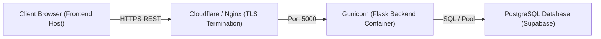

# CAMPUSCRAFTERS HACKATHON PLATFORM — DEPLOYMENT & DEVOPS GUIDE
## Infrastructure Specification for DevOps Engineer (Atharv Sherkar)

**Document Version:** 1.0.0 (Phase 2 Architecture)  
**Date:** November 4, 2026  
**Audience:** Atharv Sherkar (DevOps Engineer)  
**Stack:** Python 3.11, Flask 3.1, Gunicorn 23.0, PostgreSQL (Supabase), Docker

---

## 1. Architecture Overview

The backend is deployed as a standalone containerized service behind a reverse proxy (Nginx or Cloudflare) with HTTPS termination.



---

## 2. Environment Variables Checklist

| Variable Name | Required | Default | Description |
| :--- | :---: | :--- | :--- |
| `FLASK_ENV` | **Yes** | `production` | Set to `production` in live deployment. Fails fast if memory repo used. |
| `SECRET_KEY` | **Yes** | *(none)* | 64-character cryptographically random string for Flask session signing. |
| `JWT_SECRET_KEY`| **Yes** | *(none)* | 64-character cryptographically random secret for JWT signing. |
| `JWT_EXPIRATION_SECONDS` | No | `86400` | Token validity duration in seconds (24 hours). |
| `CORS_ALLOWED_ORIGINS` | **Yes** | *(none)* | Comma-separated list of allowed frontend origins (e.g. `https://campuscrafters.com`). |
| `DATABASE_URL` | **Yes** | *(none)* | PostgreSQL / Supabase connection string. Required in production. |
| `MIN_TEAM_SIZE` | No | `2` | Minimum team size required at final submission. |
| `MAX_TEAM_SIZE` | No | `5` | Maximum team size allowed per team. |
| `SUBMISSION_DEADLINE_UTC`| No | *(null)* | ISO 8601 UTC timestamp string (e.g. `2026-11-15T18:30:00Z`). |
| `PORT` | No | `5000` | Port for Gunicorn server to bind. |
| `LOG_LEVEL` | No | `INFO` | Logging level (`DEBUG`, `INFO`, `WARNING`, `ERROR`). |

---

## 3. Production Persistence Guard

The application factory strictly enforces that in-memory repositories cannot run in production:
```python
if config_name == "production" or app.config.get("ENV") == "production":
    db_url = app.config.get("DATABASE_URL")
    repo_type = app.config.get("REPOSITORY_TYPE")
    if not db_url or repo_type == "memory":
        raise RuntimeError("CRITICAL SECURITY GUARD: In-memory persistence is strictly forbidden in production.")
```
Ensure `DATABASE_URL` is set in the production deployment environment.

---

## 4. Docker Deployment

### Building the Image:
```bash
docker build -t campuscrafters-backend:latest -f Dockerfile .
```

### Running the Container:
```bash
docker run -d \
  --name campuscrafters-api \
  -p 5000:5000 \
  --env-file .env \
  campuscrafters-backend:latest
```

### Health Probing:
- Probe URL: `GET /api/v1/health`
- Expected response: `HTTP 200` with `{"success": true, "data": {"status": "healthy", ...}}`


---

## Backend Completion Notes (Persistence, SSO, Hardening)

### Persistence
`REPOSITORY_TYPE` is chosen by the Flask profile: `development`/`testing` use the seeded in-memory adapters, `production` uses PostgreSQL via `app/repositories/factory.py`. All ten repository interfaces now have PostgreSQL adapters (`app/repositories/postgres/`), sharing one pooled SQLAlchemy engine, so every gunicorn worker sees the same data and logout revocations.

Database setup (once, on an empty database): run `database/schema.sql` then `database/seed_production.sql`. **`schema.sql` drops and recreates every table.** `seed_development.sql` is for local demo data only.

### Startup guards (production refuses to boot when)
- `DATABASE_URL` is empty or the repository type is `memory`;
- `SECRET_KEY` / `JWT_SECRET_KEY` are unset, are one of the documented sample values, or are shorter than 32 characters;
- `FLASK_ENV` names an unknown profile (a typo can no longer fall back to development).
The `/api/v1/auth/dev/*` routes return 404 whenever the active profile is `production`.

### SSO
`GET /api/v1/auth/sso/login` + `POST /api/v1/auth/sso/callback` implement OIDC authorization-code flow with `state`, `nonce` and PKCE, server-side code exchange, and ID-token verification (signature via provider JWKS, `iss`, `aud`, `exp`, `nbf`, 60 s leeway). Users are provisioned as plain participants by e-mail; roles (`judge`, `admin`) are assigned only in the database, never from provider claims. Required environment: `SSO_CLIENT_ID`, `SSO_CLIENT_SECRET`, `SSO_DISCOVERY_URL`, `SSO_REDIRECT_URI`. The frontend and API are on different origins, so the flow cookie is `SameSite=None; Secure` in production and CORS must list the exact frontend origin in `CORS_ALLOWED_ORIGINS`.

### Granting judge / admin roles
Roles live in `users.roles`, e.g. `UPDATE users SET roles = '{participant,judge}' WHERE email = 'judge@college.edu';` (the user signs in again to receive a token carrying the new roles).

### Health
`GET /api/v1/health` also probes the database and returns HTTP 503 with `"database": "unreachable"` when it cannot be reached, suitable for load-balancer checks.

### Running the tests
```
pytest                                   # unit + in-memory integration (no database needed)
TEST_DATABASE_URL=postgresql+psycopg2://user:pw@localhost/campus_test pytest tests/integration/test_postgres_backend.py
```
The Postgres suite exercises the whole participant-to-judge lifecycle over HTTP against a real database; use a disposable database because it recreates the schema.
