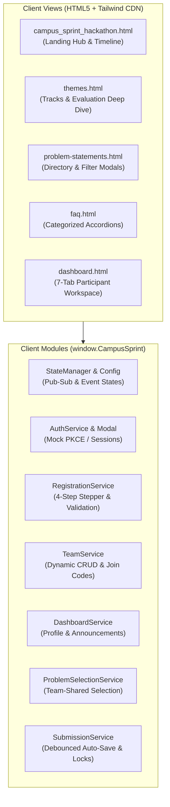

# CAMPUSCRAFTERS HACKATHON PLATFORM — FLASK BACKEND
## Comprehensive Codebase Audit, Architectural Specification & Implementation Blueprint

**Document Version:** 2.2.0 (Phase 1.5 Contract-Consistency Revision)  
**Audit Date:** November 4, 2026  
**System Target:** CampusCrafters 24-Hour Diwali Hackathon Platform (Campus Sprint 2026)  
**Authors / Roles:** Mangesh Mahajan & Vaibhav Patil Dhumal (Backend & API Engineering)  
**Target Repository:** `CampusCrafters_DiwaliHackthon_Platform`  
**Phase:** Phase 1.5 — Final Contract-Consistency Audit & Technical Blueprint  

---

## Table of Contents
1. [Division of Engineering Responsibilities & Governance Principles](#1-division-of-engineering-responsibilities--governance-principles)
2. [Existing Frontend Architecture & Feature Inventory](#2-existing-frontend-architecture--feature-inventory)
3. [Verified Domain Business Rules vs Provisional Assumptions](#3-verified-domain-business-rules-vs-provisional-assumptions)
4. [Authentication, Identity & Token Revocation Architecture](#4-authentication-identity--token-revocation-architecture)
5. [Team Join-Code Architecture & Seed Compatibility](#5-team-join-code-architecture--seed-compatibility)
6. [Submission Deadline Architecture & UTC Enforcement](#6-submission-deadline-architecture--utc-enforcement)
7. [Proposed Backend Modular Architecture (Flask)](#7-proposed-backend-modular-architecture-flask)
8. [Persistence Architecture & Memory Repository Limitations](#8-persistence-architecture--memory-repository-limitations)
9. [Canonical REST API Contract Overview](#9-canonical-rest-api-contract-overview)
10. [Client Automated Test Analysis (Scratch Suites)](#10-client-automated-test-analysis-scratch-suites)
11. [Database Handover, Repository Interfaces & Seed Separation](#11-database-handover-repository-interfaces--seed-separation)
12. [Evaluator & Administrative Operations Specifications](#12-evaluator--administrative-operations-specifications)
13. [Frontend-to-Backend Integration Mapping](#13-frontend-to-backend-integration-mapping)
14. [Decisions Requiring Project-Lead Approval](#14-decisions-requiring-project-lead-approval)

---

## 1. Division of Engineering Responsibilities & Governance Principles

The CampusCrafters Diwali Hackathon Platform (*Campus Sprint 2026*) is a 24-hour hackathon operations portal. Its architecture is explicitly partitioned across separate engineering roles:

| Engineering Role | Assignee | Scope of Ownership & Explicit Boundaries |
| :--- | :--- | :--- |
| **Backend & API Engineering** | **Mangesh Mahajan & Vaibhav Patil Dhumal** (Us) | **Sole Ownership:** Core server-side application architecture, Flask REST API endpoints, business logic validation services, request/response DTO schemas, authentication/authorization middleware, abstract repository interfaces, thread-safe in-memory test harnesses, and integration contracts.<br>**Strict Boundary:** Do not implement PostgreSQL tables, migrations, database engines, or frontend UI code. |
| **Database Engineering** | **Atharva Kharat** | **Sole Ownership:** Database architecture, relational schemas, PostgreSQL/Supabase configuration, table definitions, foreign key constraints, indexes, migrations, connection pooling, and implementing concrete SQL repository adapters satisfying the backend interfaces. |
| **Frontend Engineering & UI/UX** | **Ayush Jain** | **Sole Ownership:** HTML5, CSS/Tailwind Neo-Brutalist design tokens, Vanilla JavaScript client modules (`window.CampusSprint`), view controllers, animations (GSAP), and responsive UI layouts.<br>**Strict Boundary:** Backend must not rewrite or alter existing frontend UI code. |
| **DevOps & Infrastructure** | **Atharv Sherkar** | **Sole Ownership:** Multi-server deployment, independent hosting for frontend and backend, HTTPS certificates, reverse proxy configuration, Discord bot/webhook infrastructure, and CI/CD pipelines. |
| **Project Lead & System Architect** | **Pranit Khandade** | **Sole Ownership:** Product requirements, milestone tracking, global workflow design, and resolving provisional business assumptions. |

### Architectural Governance Principles
1. **Independent Deployability:** Frontend and backend run on isolated servers with distinct origins. All client-server communication occurs via standard HTTPS RESTful JSON APIs with properly configured CORS (Cross-Origin Resource Sharing).
2. **Layered Separation of Concerns:** Route handlers (Flask Blueprints) must never contain raw business logic. Business logic resides strictly in domain service classes.
3. **Database Layer Decoupling:** The backend defines abstract repository interfaces (`abc.ABC`). The backend provides an in-memory repository adapter **strictly for local development and unit testing**. Atharva Kharat implements the persistent PostgreSQL/Supabase adapters against these identical interfaces.
4. **Zero Frontend Regressions:** The existing frontend JavaScript modules (`window.CampusSprint`) define the client-side behavioral contract.
5. **Universal UTC Timestamps:** Every timestamp across contracts and responses must strictly follow ISO 8601 UTC formatted with a trailing `Z` (e.g. `2026-11-04T12:00:00Z`).
6. **No Invented Specifications:** Where system parameters (e.g., exact deadlines, production SSO client secrets) are unfinalized, they must be represented as configurable environment variables or `null` defaults.

---

## 2. Existing Frontend Architecture & Feature Inventory

The frontend is an offline-capable, zero-bundler application built with modern HTML5, Tailwind CSS (via CDN), Google Fonts (*Bricolage Grotesque* and *DM Sans*), GSAP 3.12.2, and Vanilla ES6+ JavaScript scoped under the `window.CampusSprint` namespace.



### Detailed Inventory of Existing Client Views

#### A. Landing Page (`campus_sprint_hackathon.html`)
- **Sticky Navigation:** SVG branding, desktop navigation links, responsive slide-out mobile drawer, and state-reactive dynamic CTA buttons (`Register`, `Go to Dashboard`, `Join Waitlist`, `View Pass`).
- **Hero Banner:** Urgency pills, animated Neo-Brutalist 12s rotating badge, dynamic headline swipe, and action CTAs.
- **About & Live Countdown:** Real-time JavaScript delta ticker calculating remaining time to kickoff or deadline, flanked by 3 core platform pillars (Build, Learn, Win).
- **How It Works:** 4-step sequential explanation (Register & Team Up, Pick Challenge, 24h Build Sprint, Live Evaluation).
- **Tracks Grid:** Interactive cards for FinTech, Social Good, Web3, and Beginner tracks.
- **Horizontal 24h Schedule Timeline:** GSAP ScrollTrigger pinned horizontal timeline scrubber featuring 7 chronological milestones.
- **Prizes Ribbon:** Neo-Brutalist cards highlighting the \$5,000 Grand Prize and track-specific pool allocations.
- **Mentors, Judges & Organizers:** Profile grids with physical border drop-shadows and hover reveal states.
- **Virtual Logistics:** Explains Discord stages, GitHub commit tracking, and Zoom mentorship channels.
- **FAQ Accordion:** Pure CSS Grid animated disclosure widgets (`grid-template-rows: 0fr -> 1fr`).
- **Authentication Dialog:** Accessible modal (`#auth-modal`) supporting simulated login, signup, password reset dispatch, and session synchronization.

#### B. Public Pages
- **Themes & Tracks Deep Dive (`themes.html`):** Track breakdown displaying evaluation weights, problem prompts, starter ideas, and deep-links to selection.
- **Problem Statements Directory (`problem-statements.html`):** 6 problem statements with track filter tabs, search input, difficulty badges, and detail modal (`#ps-modal`). Deep-linked to dashboard with "Select Problem in Dashboard" buttons.
- **FAQ Page (`faq.html`):** Categorized accordion directory (General, Eligibility, Teams, Submissions, Logistics) with live client-side search filtering.

#### C. Participant Dashboard (`dashboard.html`)
Driven by `CampusSprint.DashboardController` across 7 reactive tab panes:
1. **Overview Pane:** Active hackathon phase banner, live countdown timer, quick action pills, team roster summary card, and announcement preview.
2. **My Profile Pane:** Editable user profile (display name, bio, college, degree course, academic year, technical skills) with live avatar preview.
3. **My Team Workspace Pane:** Dynamic workspace showing team name, 6-character copyable join code (`CS-XXXX` or seed code), member roster with role badges, leader controls (rename team, regenerate join code, remove member, transfer leadership, disband team), and create/join forms for unteamed participants.
4. **Problem Selection Pane:** Team-shared problem statement browser and lock-in interface with permission gating (leader-only selection/change/clear), non-leader notices, and post-submission freeze locks.
5. **Project Submission Pane:** Submission management interface featuring an 800ms debounced auto-save mechanism, draft persistence, field validations, strict HTTPS repository validation, submission review confirmation dialog (`#submission-review-modal`), and permanent lock enforcement once submitted.
6. **Announcements Feed Pane:** Categorized notification feed (`All`, `Urgent`, `Platform`, `Mentorship`) with unread badge counters, unread indicator dots, and "Mark All as Read" action.
7. **Event Info & Guidelines Pane:** Event schedule, rules of conduct, submission checklist, and support links.
- **Embedded Modals:**
  - **Digital Hacker Pass Modal (`#pass-modal`):** Neo-Brutalist virtual event ticket featuring QR code generator, participant ID, track badge, and college metadata.
  - **Problem Statement Detail Modal (`#dash-ps-modal`):** Full technical prompt, constraints, deliverables, and scoring criteria.
  - **Submission Review Modal (`#submission-review-modal`):** Pre-submission confirmation displaying project links and immutability warning checkbox.

---

## 3. Verified Domain Business Rules vs Provisional Assumptions

### A. Verified Frontend Behaviors (Empirically Confirmed)
1. **Event State Machine:** 8 distinct states: `teaser`, `reg_open`, `almost_full`, `full`, `reg_closed`, `event_live`, `judging`, `results`. Registration is permitted **only** during `reg_open` and `almost_full`.
2. **Visitor Identity States:** `logged_out`, `logged_in_unregistered`, `registered`. Unregistered participants are barred from team creation, joining, problem selection, and submissions.
3. **Strict 1-Team-Per-User Rule:** A participant can belong to at most one team at any time.
4. **Team Leadership Hierarchy:**
   - The team creator is assigned `leader_id`.
   - Only the leader can rename the team, regenerate the join code, remove members, transfer leadership, or disband the team.
   - A leader cannot leave a multi-member team without transferring leadership or disbanding.
   - A sole leader leaving disbands the team automatically.
5. **Problem Selection Authority & Shared State:**
   - The problem statement selection belongs to the team entity, not individual users.
   - Only the team leader can select, change, or clear the selection.
   - Non-leaders receive read-only views with leader contact details.
6. **Submission Validation & Post-Submission Lockout:**
   - Title (3–100 chars), Tagline (10–250 chars), Description (>=30 chars), and Tech Stack (>=1 tag) are mandatory.
   - Repository URL must strictly validate against HTTPS syntax (`https://...`).
   - Final submission permanently locks editing of both the draft and the problem statement selection.

### B. Catalog of Provisional Assumptions & Configurable Limits

| # | Parameter | Location in Code | Provisional Default | Rationale & Status |
| :-: | :--- | :--- | :--- | :--- |
| **1** | **Max Team Size** | `state-config.js:59`<br>`team-service.js:14` | `5` members (Configurable) | `README.md` states "2-4 members", but frontend code and mock validations enforce `5`. Defaulting to 5 with environment variable `MAX_TEAM_SIZE` until the project lead confirms whether 4 or 5 is the final cap. |
| **2** | **Min Team Size** | `state-config.js:58` | `2` members (Configurable) | Enforced at final submission execution, not during team creation. Configured via `MIN_TEAM_SIZE=2`. |
| **3** | **Solo Participation** | `state-config.js:60` | `false` | Solo hacking is explicitly disabled in client config to encourage Discord matchmaking. |
| **4** | **Submission Deadline** | `state-config.js:78` | `null` | Exact ISO 8601 UTC epoch timestamp is unfinalized; falls back cleanly to event state gate (`event_live`). |
| **5** | **Resubmission Permission** | `state-config.js:71` | `false` | Once submitted, projects are locked for evaluation. |
| **6** | **Live Demo URL Mandatory**| `state-config.js:75` | `false` (Optional) | Kept optional to accommodate teams without cloud deployment budgets. |
| **7** | **Presentation Video URL** | `state-config.js:77` | `false` (Optional) | Kept optional to prevent blocking participants with bandwidth limitations. |
| **8** | **Problem Statement Change**| `state-config.js:69` | `true` (Before submit) | Leaders can pivot challenges prior to final submission. |

---

## 4. Authentication, Identity & Token Revocation Architecture

### A. Development vs Production Authentication
- **Production Architecture (Campus Crafter SSO):** In production, authentication is handled **exclusively via Campus Crafter SSO (OAuth2 / OIDC)**. There are **no password tables, password hashes, or local password authentications in production**. The backend exchanges the SSO authorization code or validates signed OIDC JWTs, provisions the local user, and issues a platform API access token.
- **Development Architecture (Mock Auth):** For local offline development and automated testing, mock authentication routes (`/api/v1/auth/dev/*`) mirror the frontend mock accounts (`p-001`, `p-002`, `u-demo-unreg`).
- **Production Guard:** In production mode (`FLASK_ENV=production`), all `/api/v1/auth/dev/*` routes are disabled and return HTTP 404.

### B. Production SSO Security Architecture & Unresolved Specifications
1. **CSRF Mitigation via `state`:** The client initiates the SSO flow by generating a cryptographically random `state` string stored in an encrypted, HttpOnly cookie. The callback endpoint verifies the returned `state`. Mismatches return HTTP 400 `INVALID_STATE`.
2. **Replay Protection via `nonce`:** An unguessable `nonce` is included in the OIDC authorization request and validated against the `nonce` claim in the received ID token.
3. **Backend Code Exchange:** The authorization code is exchanged directly by the Flask server over TLS HTTPS with the SSO provider's token endpoint.
4. **JWT Verification Configuration:**
   - Signatures verified against the provider's JWKS public keys fetched from `/.well-known/jwks.json` and cached with TTL.
   - Strict claim verification: `iss` (Issuer URL), `aud` (Client ID), `exp` (Future UTC timestamp), and `nbf`.
5. **Explicitly Unresolved Provider Details:** The exact SSO Provider Issuer URL, Client ID, Client Secret, JWKS URL, and user claims mappings remain **unresolved pending project-lead provisioning**.

### C. Server-Side Token Revocation & Logout Strategy
- **Mechanism:** JWTs carry a unique identifier claim (`jti`) and expiration claim (`exp`).
- **Logout Action:** When `POST /api/v1/auth/logout` is called:
  1. The server extracts the `jti` and `exp` from the active Bearer token.
  2. The server records `jti`, `user_id`, and `expires_at` into the persistence layer (`revoked_tokens` table / Redis cache).
- **Enforcement:** The `@require_auth` middleware checks incoming tokens against the revocation repository. Revoked tokens immediately return HTTP 401 `UNAUTHORIZED`.
- **Garbage Collection:** Expired revoked tokens (`expires_at < NOW()`) are purged periodically to maintain minimal table size.

---

## 5. Team Join-Code Architecture & Seed Compatibility

### Analysis of Existing Join Codes
- **Existing Seed Teams (`frontend/js/data/teams.js`):**
  - `team-001` (CodeCatalysts): `CC-4F7K`
  - `team-002` (ChainGang): `CG-9R2M`
  - `team-003` (ImpactHackers): `IH-6T1N`
- **Dynamic Code Generator (`team-service.js:26`):**
  - Generates codes with a fixed prefix: `CS-XXXX` using character pool `ABCDEFGHJKLMNPQRSTUVWXYZ23456789`.

### Canonical Join-Code Standard
1. **Newly Generated Codes:** Must follow the `CS-XXXX` standard (prefix `CS-` + 4 uppercase alphanumeric characters).
2. **Seed Compatibility:** The backend validation regex accepts both seed formats and new formats: `^[A-Z]{2}-[A-Z0-9]{4}$`.
3. **Normalization & Case-Insensitivity:** All join-code lookups normalize user input with `.strip().upper()`.
4. **Uniqueness:** The database and in-memory repositories enforce uniqueness on `UPPER(join_code)`.

---

## 6. Submission Deadline Architecture & UTC Enforcement

### Handling Unconfigured Deadlines
- The audit explicitly removes any unconfirmed sample deadlines.
- In the absence of an explicit deadline timestamp, `submission_deadline_utc` defaults strictly to `null`.
- When `submission_deadline_utc` is `null`, submission locking is governed exclusively by the event state (`event_state !== 'event_live'` locks submissions).

### UTC Timestamp Enforcement
When a deadline is configured via environment variable (`SUBMISSION_DEADLINE_UTC`), the backend enforces the following:
1. **Standard Format:** Deadlines must parse as ISO 8601 UTC strings ending in `Z` (e.g., `2026-11-15T18:30:00Z`).
2. **Server-Side Enforcement:** Every submission draft update and final submission checks:
   ```python
   if config.submission_deadline_utc and datetime.now(timezone.utc) > config.submission_deadline_utc:
       raise DeadlineExpiredError("The hackathon submission deadline has passed.")
   ```
3. **HTTP Status Code:** Expired requests return HTTP 423 (Locked) with error code `DEADLINE_EXPIRED`.

---

## 7. Proposed Backend Modular Architecture (Flask)

The backend is built in Python using Flask with an Application Factory pattern and strict layered separation:

```
backend/
├── app.py                       # WSGI entrypoint
├── requirements.txt             # Pinned production dependencies
├── requirements-dev.txt         # Testing & linting dependencies
├── .env.example                 # Environment template
│
├── src/
│   ├── __init__.py              # Application factory (create_app)
│   ├── config.py                # Environment-driven configuration
│   │
│   ├── common/                  # Cross-cutting concerns
│   │   ├── exceptions.py        # Domain exception hierarchy
│   │   ├── error_handlers.py    # Global Flask JSON error handlers
│   │   ├── responses.py         # Standardized JSON response envelope helpers
│   │   ├── security.py          # JWT utilities & token decoding
│   │   └── middleware.py        # Request context, timing, rate limiting, CORS setup
│   │
│   ├── domain/                  # Pure Domain Entities (Dataclasses)
│   │   ├── user.py
│   │   ├── registration.py
│   │   ├── team.py
│   │   ├── track.py
│   │   ├── problem_statement.py
│   │   ├── submission.py
│   │   ├── announcement.py
│   │   └── event_state.py
│   │
│   ├── interfaces/              # Abstract Repository Interfaces (Contract for DB Dev)
│   │   ├── track_repository.py
│   │   ├── user_repository.py
│   │   ├── registration_repository.py
│   │   ├── team_repository.py
│   │   ├── problem_repository.py
│   │   ├── submission_repository.py
│   │   ├── announcement_repository.py
│   │   ├── token_revocation_repository.py
│   │   ├── evaluation_repository.py
│   │   └── event_config_repository.py
│   │
│   ├── repositories/            # In-Memory Thread-Safe Repositories (Dev/Test Only)
│   │   ├── memory_track_repo.py
│   │   ├── memory_user_repo.py
│   │   ├── memory_registration_repo.py
│   │   ├── memory_team_repo.py
│   │   ├── memory_problem_repo.py
│   │   ├── memory_submission_repo.py
│   │   ├── memory_announcement_repo.py
│   │   ├── memory_token_revocation_repo.py
│   │   ├── memory_evaluation_repo.py
│   │   └── memory_event_config_repo.py
│   │
│   ├── services/                # Pure Business Logic Layer
│   │   ├── auth_service.py
│   │   ├── registration_service.py
│   │   ├── profile_service.py
│   │   ├── team_service.py
│   │   ├── problem_service.py
│   │   ├── submission_service.py
│   │   ├── announcement_service.py
│   │   ├── evaluation_service.py
│   │   └── event_state_service.py
│   │
│   └── api/                     # HTTP Delivery Layer (Flask Blueprints)
│       ├── decorators.py        # @require_auth, @require_team_leader
│       └── v1/
│           ├── auth_routes.py
│           ├── registration_routes.py
│           ├── profile_routes.py
│           ├── team_routes.py
│           ├── track_routes.py
│           ├── problem_routes.py
│           ├── submission_routes.py
│           ├── announcement_routes.py
│           ├── evaluator_routes.py
│           ├── admin_routes.py
│           └── health_routes.py
│
├── tests/                       # Pytest Automated Test Suites
│   ├── conftest.py
│   ├── unit/                    # Domain logic & validation tests
│   └── integration/             # Full HTTP API client tests
│
└── docs/                        # Specifications & Contracts
    ├── IMPLEMENTATION_AUDIT.md  # This document
    ├── API_CONTRACT.md          # Canonical endpoint specification
    └── DATABASE_INTEGRATION.md  # Database handover specification
```

---

## 8. Persistence Architecture & Memory Repository Limitations

### In-Memory Repositories Are Development-Only
The in-memory repository implementations (`src/repositories/memory_*`) are designed **solely for rapid development and isolated automated pytest execution**.

### Multi-Worker & Concurrency Limitations
- **No Cross-Worker Sharing:** Python in-memory data structures are bound to a single OS process memory space. In production WSGI servers (Gunicorn, uWSGI) utilizing multiple worker processes, each worker maintains an independent memory space. Requests routed across different workers will see completely divergent state.
- **Process Termination:** Restarting or scaling containers completely wipes in-memory state.
- **Thread Safety (`threading.RLock`):** Protects concurrent threads within a single process from memory corruption, but provides zero persistence across processes or server restarts.

### Production Startup Gate
In production (`FLASK_ENV=production` or `ENV=production`), the application factory enforces:
```python
if config.ENV == "production":
    if not config.DATABASE_URL:
        raise RuntimeError("FATAL: DATABASE_URL must be configured in production.")
    if config.REPOSITORY_TYPE == "memory":
        raise RuntimeError("FATAL: Memory repository persistence is forbidden in production.")
```

---

## 9. Canonical REST API Contract Overview

The complete canonical API specification is codified in [`backend/docs/API_CONTRACT.md`](file:///d:/campus_crafter/24hrs_hackthon/CampusCrafters_DiwaliHackthon_Platform/backend/docs/API_CONTRACT.md). Below is the reconciled endpoint summary:

### System & Health
- `GET /api/v1/health` — System uptime and health.
- `GET /api/v1/config/state` — Global event state, countdown flags, and public configuration.

### Authentication
- `POST /api/v1/auth/dev/login` — Development login (disabled in production).
- `POST /api/v1/auth/dev/signup` — Development signup (disabled in production).
- `POST /api/v1/auth/sso/callback` — Production SSO code exchange.
- `GET /api/v1/auth/me` — Current authenticated user profile, roles, and team association.
- `POST /api/v1/auth/logout` — Session revocation (adds `jti` to server-side denylist).
- `POST /api/v1/auth/forgot-password` — Generic reset dispatch.

### Registration & Waitlist
- `POST /api/v1/registrations` — Submit hackathon registration (gated to `reg_open` / `almost_full`).
- `GET /api/v1/registrations/me` — Retrieve registration and virtual ticket pass.
- `POST /api/v1/registrations/waitlist` — Submit waitlist application when event state is `full`.

### User Profile
- `GET /api/v1/profile/me` — Aggregated participant profile and badge details.
- `PUT /api/v1/profile/me` — Update bio, skills, college, and academic year.

### Tracks & Problem Statements
- `GET /api/v1/tracks` — List all 4 competition tracks.
- `GET /api/v1/problem-statements` — List problem statements with filter support.
- `GET /api/v1/problem-statements/{id}` — Full problem statement prompt and rubric.

### Team Workspace
- `GET /api/v1/teams` — List teams / directory query (filters: `?track_id=`, `?status=`).
- `POST /api/v1/teams` — Create team (generates unique `CS-XXXX` join code, sets creator as leader).
- `GET /api/v1/teams/me` — Get current user's team workspace with member roster.
- `POST /api/v1/teams/join` — Join team via code (`CC-4F7K` or `CS-XXXX`, capacity limit `MAX_TEAM_SIZE`).
- `POST /api/v1/teams/leave` — Leave team (leaders must transfer leadership or disband).
- `PATCH /api/v1/teams/{id}/name` — Rename team (leader only).
- `POST /api/v1/teams/{id}/regenerate-code` — Regenerate join code (leader only).
- `DELETE /api/v1/teams/{id}/members/{user_id}` — Remove member (leader only).
- `POST /api/v1/teams/{id}/transfer-leadership` — Transfer team leadership (leader only).
- `DELETE /api/v1/teams/{id}` — Disband team (leader only).

### Problem Statement Selection
- `GET /api/v1/teams/{id}/problem-statement` — Get team's selected challenge.
- `PUT /api/v1/teams/{id}/problem-statement` — Select or change challenge (leader only, locked post-submission).
- `DELETE /api/v1/teams/{id}/problem-statement` — Clear selection (leader only, locked post-submission).

### Submissions & Draft Auto-Save
- `GET /api/v1/teams/{id}/submission` — Get team's submission record.
- `PUT /api/v1/teams/{id}/submission/draft` — Auto-save draft (leader only, low latency, partial payloads, allowed before problem selection).
- `POST /api/v1/teams/{id}/submission/submit` — Final submit (leader only, validates `>= MIN_TEAM_SIZE`, active problem selection, and required fields; permanent lock).

### Announcements
- `GET /api/v1/announcements` — List announcements (supports `?category=` and `?priority=` filters).
- `POST /api/v1/announcements/{id}/read` — Mark announcement as read.
- `DELETE /api/v1/announcements/{id}/read` — Mark announcement as unread.
- `POST /api/v1/announcements/read-all` — Mark all announcements as read.

### Evaluator & Operations (Phase 8)
- `GET /api/v1/evaluator/submissions` — List locked submitted projects for review.
- `GET /api/v1/evaluator/submissions/{id}` — Get single submission detail for scoring.
- `POST /api/v1/evaluator/submissions/{id}/scores` — Submit rubric score (upsert; computes `total_score`).

### Admin Command Console
- `PATCH /api/v1/admin/event-state` — Override global event state.
- `POST /api/v1/admin/announcements` — Broadcast flash announcement.
- `PATCH /api/v1/admin/deadline` — Set or override global submission deadline.
- `PATCH /api/v1/admin/problem-statements/{id}/toggle` — Toggle problem unlock status.

---

## 10. Client Automated Test Analysis (Scratch Suites)

The frontend codebase contains two automated test suites in `frontend/scratch/`:

### Inspection Details
1. **`frontend/scratch/test_phase6.js`:**
   - Contains **87 `assert()` statements** covering `CampusSprint.Teams` (capacity, join codes, leadership actions, disbanding), `CampusSprint.Dashboard` (profiles, announcements), and navigation regression assertions.
2. **`frontend/scratch/test_phase7.js`:**
   - Contains **78 `assert()` statements** covering `CampusSprint.ProblemSelection` (team-shared selections, leader gates, lockouts) and `CampusSprint.Submissions` (drafts, HTTPS validation, final lockouts).
3. **Combined Count:** Exactly **165 assertion statements**.

### Execution Context & Portability Note
- **Workstation Path Dependency:** Both test files contain a hardcoded development root from the original frontend author's machine (`const baseDir = 'E:\\Hackathon\\New Design';`).
- **Execution Reality:** These tests cannot be executed in the current environment without modifying `baseDir` and having a local Node.js runtime.
- **Reporting Correction:** These 165 assertions reflect the historical test suite reported in `CAMPUSCRAFTERS_PROJECT_AUDIT.md`. They were **not executed during this backend audit session**, and must not be misrepresented as verified runs in the current workspace.

---

## 11. Database Handover, Repository Interfaces & Seed Separation

The complete database integration requirements for **Atharva Kharat** are codified in [`backend/docs/DATABASE_INTEGRATION.md`](file:///d:/campus_crafter/24hrs_hackthon/CampusCrafters_DiwaliHackthon_Platform/backend/docs/DATABASE_INTEGRATION.md).

### Python Abstract Repository Interfaces
The backend defines 10 abstract base classes in `src/interfaces/`:
1. `ITrackRepository` (`list_all`, `get_by_id`)
2. `IUserRepository` (`get_by_id`, `get_by_email`, `create_user`, `update_user`)
3. `IRegistrationRepository` (`create_registration`, `get_by_user_id`, `get_by_email`, `get_by_ticket_code`, `create_waitlist_entry`)
4. `ITeamRepository` (`list_all`, `create_team`, `get_by_id`, `get_by_join_code`, `get_by_user_id`, `add_member`, `remove_member`, `transfer_leadership`, `update_name`, `regenerate_join_code`, `disband_team`)
5. `IProblemRepository` (`list_all`, `get_by_id`, `get_selection`, `save_selection`, `clear_selection`, `update_active_status`)
6. `ISubmissionRepository` (`get_by_team_id`, `save_draft`, `submit_project`, `sync_problem_statement`)
7. `IAnnouncementRepository` (`list_all`, `get_by_id`, `create_announcement`, `get_read_ids_for_user`, `mark_read`, `mark_unread`, `mark_all_read`)
8. `ITokenRevocationRepository` (`revoke_token`, `is_token_revoked`, `purge_expired_tokens`)
9. `IEvaluationRepository` (`list_submissions_for_evaluation`, `get_submission_scores`, `get_score_by_judge`, `submit_score`)
10. `IEventConfigRepository` (`get_config`, `set_event_state`, `set_submission_deadline`)

### Strict Seed Separation: Production vs Development
1. **Production Seed Profile (`seed_production`):** Seeds **only** foundational platform reference data (`tracks`, `problem_statements`, `event_config`). Mock accounts, demo teams, and test submissions are **never** seeded into production.
2. **Development Seed Profile (`seed_development`):** Seeds demo users (`p-001` through `p-008`, `u-demo-unreg`), sample registrations, teams (`team-001`..`team-003`), memberships, problem selections, sample submissions, and announcements. Executed strictly when `FLASK_ENV=development` or via `flask seed-demo`.

---

## 12. Evaluator & Administrative Operations Specifications

### A. Evaluator / Judging Operations
- **Business Purpose:** Allows judges to review submitted projects, inspect GitHub repositories and demo links, and submit scores against hackathon evaluation criteria.
- **Criteria Weights & Sum Enforcement:** Innovation (0..30), Technical Execution (0..30), UI/UX & Design (0..20), Community Impact (0..20). `total_score` (0..100) is strictly enforced as the computed sum of all four rubric fields.
- **Repeat Submissions:** Judges may re-evaluate or update their scores via upsert on `(submission_id, judge_id)` until the judging window closes.
- **Database Table:** `evaluation_scores` with composite unique constraint `(submission_id, judge_id)` and formula CHECK constraint.
- **Endpoints:** `GET /api/v1/evaluator/submissions`, `GET /api/v1/evaluator/submissions/{id}`, `POST /api/v1/evaluator/submissions/{id}/scores`.

### B. Administrative Operations (Admin Command Console)
- **Business Purpose:** Allows platform administrators to broadcast emergency flash announcements, transition event lifecycle states, set global deadlines, and toggle problem statement visibility.
- **Database Table:** `event_config` storing key-value pairs (`event_state`, `submission_deadline_utc`, `min_team_size`, `max_team_size`) with audit timestamps and admin IDs.
- **Endpoints:** `PATCH /api/v1/admin/event-state`, `POST /api/v1/admin/announcements`, `PATCH /api/v1/admin/deadline`, `PATCH /api/v1/admin/problem-statements/{id}/toggle`.

---

## 13. Frontend-to-Backend Integration Mapping

| Client Domain | Existing Frontend JavaScript Method | Storage Mechanism | Canonical Backend REST Endpoint | Method |
| :--- | :--- | :--- | :--- | :---: |
| **State** | `CampusSprint.stateManager.getSnapshot()` | `cs26_event_state` | `/api/v1/config/state` | `GET` |
| **Auth** | `CampusSprint.Auth.login(email, password)` | `cs26_mock_accounts` | `/api/v1/auth/dev/login` | `POST` |
| **Auth** | `CampusSprint.Auth.signup(data)` | `cs26_mock_accounts` | `/api/v1/auth/dev/signup` | `POST` |
| **User Session** | `CampusSprint.Auth.getCurrentUser()` | `cs26_current_user` | `/api/v1/auth/me` | `GET` |
| **User Logout** | `CampusSprint.Auth.logout()` | `cs26_current_user` | `/api/v1/auth/logout` | `POST` |
| **Registration** | `CampusSprint.Registration.submitRegistration(data)` | `cs26_registrations` | `/api/v1/registrations` | `POST` |
| **Waitlist** | `CampusSprint.Registration.submitWaitlist(data)` | `cs26_waitlist` | `/api/v1/registrations/waitlist` | `POST` |
| **Profile** | `CampusSprint.Dashboard.getUserProfile(id)` | `cs26_profile_edits` | `/api/v1/profile/me` | `GET` |
| **Profile** | `CampusSprint.Dashboard.updateUserProfile(id, data)` | `cs26_profile_edits` | `/api/v1/profile/me` | `PUT` |
| **Browse Tracks** | `Data.tracks` | `CampusSprint.Data.tracks` | `/api/v1/tracks` | `GET` |
| **Browse Problems** | `ProblemSelection.getAvailableProblemStatements()` | `Data.problemStatements` | `/api/v1/problem-statements` | `GET` |
| **Problem Detail** | `ProblemSelection.getProblemStatementById(id)` | `Data.problemStatements` | `/api/v1/problem-statements/{id}` | `GET` |
| **List Teams** | `CampusSprint.Teams.getTeams()` | `cs26_dynamic_teams` | `/api/v1/teams` | `GET` |
| **My Team** | `CampusSprint.Teams.getUserTeam(userId)` | `cs26_team_memberships` | `/api/v1/teams/me` | `GET` |
| **Create Team** | `CampusSprint.Teams.createTeam(userId, data)` | `cs26_dynamic_teams` | `/api/v1/teams` | `POST` |
| **Join Team** | `CampusSprint.Teams.joinTeam(userId, code)` | `cs26_dynamic_teams` | `/api/v1/teams/join` | `POST` |
| **Leave Team** | `CampusSprint.Teams.leaveTeam(userId)` | `cs26_dynamic_teams` | `/api/v1/teams/leave` | `POST` |
| **Rename Team** | `Teams.updateTeamName(leaderId, name)` | `cs26_dynamic_teams` | `/api/v1/teams/{id}/name` | `PATCH` |
| **Regen Code** | `Teams.regenerateJoinCode(leaderId)` | `cs26_dynamic_teams` | `/api/v1/teams/{id}/regenerate-code` | `POST` |
| **Remove Member** | `Teams.removeMember(leaderId, mId)` | `cs26_dynamic_teams` | `/api/v1/teams/{id}/members/{user_id}` | `DELETE` |
| **Transfer Lead** | `Teams.transferLeadership(curId, newId)`| `cs26_dynamic_teams` | `/api/v1/teams/{id}/transfer-leadership` | `POST` |
| **Disband Team** | `Teams.disbandTeam(leaderId)` | `cs26_dynamic_teams` | `/api/v1/teams/{id}` | `DELETE` |
| **Get Selection** | `ProblemSelection.getSelection(userId)` | `cs26_problem_selections` | `/api/v1/teams/{id}/problem-statement` | `GET` |
| **Select Problem**| `ProblemSelection.selectProblemStatement(...)` | `cs26_problem_selections` | `/api/v1/teams/{id}/problem-statement` | `PUT` |
| **Clear Problem** | `ProblemSelection.clearSelection(userId)` | `cs26_problem_selections` | `/api/v1/teams/{id}/problem-statement` | `DELETE` |
| **Get Submission**| `Submissions.getSubmission(userId)` | `cs26_project_submissions` | `/api/v1/teams/{id}/submission` | `GET` |
| **Auto-save** | `CampusSprint.Submissions.createOrUpdateDraft(...)` | `cs26_project_submissions` | `/api/v1/teams/{id}/submission/draft` | `PUT` |
| **Final Submit** | `Submissions.submitProject(...)` | `cs26_project_submissions` | `/api/v1/teams/{id}/submission/submit` | `POST` |
| **Announcements**| `CampusSprint.Dashboard.getAnnouncements(filter)` | `cs26_read_announcements` | `/api/v1/announcements` | `GET` |
| **Mark Read** | `Dashboard.markAnnouncementAsRead(id)` | `cs26_read_announcements` | `/api/v1/announcements/{id}/read` | `POST` |
| **Mark Unread** | `Dashboard.markAnnouncementAsUnread(id)` | `cs26_read_announcements` | `/api/v1/announcements/{id}/read` | `DELETE` |
| **Mark All Read** | `Dashboard.markAllAnnouncementsRead()` | `cs26_read_announcements` | `/api/v1/announcements/read-all` | `POST` |

---

## 14. Decisions Requiring Project-Lead Approval

Before launching production deployment, **Pranit Khandade** must formally resolve the following open decisions:

1. **Team Size Cap (4 vs 5):**
   - *Conflict:* `README.md` states 2–4 members; frontend code enforces 2–5 members.
   - *Current Implementation:* Defaults to `MIN_TEAM_SIZE=2` and `MAX_TEAM_SIZE=5` (configurable via environment variables).
   - *Decision:* Confirm whether 4 or 5 is the final upper bound.
2. **Solo Participation Policy:**
   - *Current State:* Disabled (`allowSolo: false`).
   - *Decision:* Confirm whether unteamed participants can submit projects independently if they cannot match on Discord.
3. **Official Hackathon Submission Deadline:**
   - *Current State:* `null` (falls back to event state gate).
   - *Decision:* Provide the exact ISO 8601 UTC epoch timestamp for server-side locking.
4. **Campus Crafter SSO Provisioning:**
   - *Decision:* Provide authorization endpoint, token endpoint, client ID, client secret, and JWKS URI.
5. **Resubmission Lockout Policy:**
   - *Current State:* Immutably locked upon final submission (`allowResubmission: false`).
   - *Decision:* Confirm if team leaders are permitted to retract or resubmit prior to the deadline cutoff.
